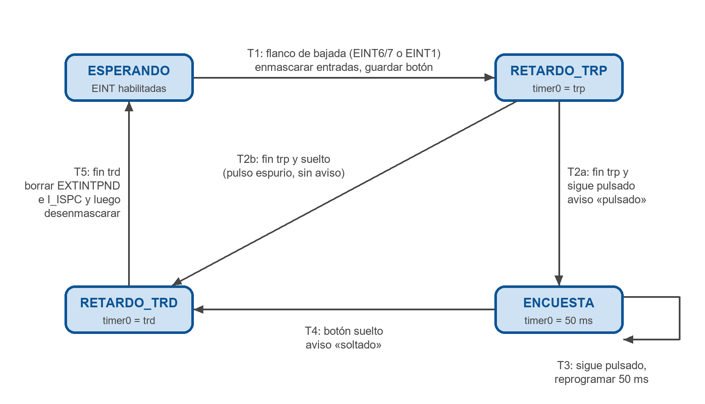
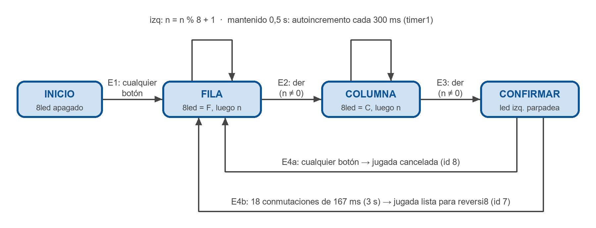

# 1. Resumen

Se ha convertido el juego Reversi de 8 casillas de la Práctica 1 en un juego que se maneja desde la propia placa Embest S3CEV40 (SoC Samsung S3C44B0X, núcleo ARM7TDMI a 64 MHz). La jugada ya no se escribe en memoria desde el depurador: se elige con los dos pulsadores y se muestra en el display de 8 segmentos, y el led izquierdo parpadea para confirmarla. El cálculo del juego sigue usando la combinación más rápida de la P1 sin optimizar (patron_volteo_arm + color_ficha_thumb).

Toda la E/S funciona por interrupciones. Se han corregido los fallos de E/S del código de partida (registros de solo escritura modificados con |=, inicializaciones que machacaban la configuración de otros dispositivos, variables compartidas sin volatile) y todos los periféricos se inicializan en una única función. Para depurar se ha añadido una pila de depuración circular de 150 eventos con marca de tiempo de timer2, situada en una dirección fija de la RAM.

Se han diseñado e implementado dos máquinas de estados. La primera elimina los rebotes de los pulsadores con el timer0: espera trp, hace encuesta cada 50 ms y espera trd. La segunda gestiona la introducción de la jugada: fila, columna, autoincremento con el timer1 y confirmación o cancelación durante 3 s. Los rebotes se han medido con la pila de depuración en tres placas distintas y varían mucho de una a otra: la ráfaga más larga pasa de 41,5 ms en la placa 12 a 67,7 ms en la placa 7, con casos sueltos de hasta 119,6 ms. Por eso trp y trd han acabado en 100 ms.

Resultados principales: se ha jugado en la placa una partida completa de 30 jugadas que llena el tablero (31 fichas blancas y 33 negras), y el tablero coincide casilla a casilla con una simulación hecha aparte. Esa prueba destapó un fallo heredado de la P1: en ARM el char es sin signo y voltear no volteaba hacia arriba ni hacia la izquierda. El juego detecta el final de la partida con un contador de casillas vacías y muestra una E en el display. Como apartado opcional se ha añadido el teclado matricial, que comparte la máquina antirrebotes; compila, pero falta comprobarlo en la placa.

# 2. Introducción

Se parte del Reversi de la Práctica 1, en el que el humano introducía su jugada escribiendo fila, columna y ready desde el depurador. En esta práctica se quita esa dependencia: el juego se maneja con los dispositivos de la placa, gestionados por interrupciones. El humano lleva negras y empieza; la máquina lleva blancas.

| Dispositivo | Uso en la práctica |
|---|---|
| Pulsadores SB2 y SB3 | Pines 6 y 7 del puerto G (EINT6 y EINT7, línea EINT4567). Pulsado = 0 en PDATG. Izquierdo = EINT6, derecho = EINT7 |
| Display de 8 segmentos | F (fila), C (columna), el número elegido (1-8) y E al acabar |
| Led izquierdo (led1) | Parpadea 3 veces por segundo durante la confirmación |
| Timer0 | Retardos de la máquina antirrebotes (un solo disparo) |
| Timer1 | Autoincremento (300 ms) y parpadeo (167 ms) |
| Timer2 | Librería de la P1: marca de tiempo en µs de la pila de depuración |
| Teclado matricial | Opcional. Banco 3 (0x0600_0000), interrumpe por EINT1 |

Tabla 1. Dispositivos de la placa usados en la práctica.

Entorno de trabajo:

- Eclipse con ARM Sourcery GCC 2011.03 (arm-none-eabi-gcc), con -O0 -mapcs-frame.
- openOCD 0.7.0 y JTAG para depurar en la placa.
- Simulador ARM7TDMI del propio entorno (target sim), usado para la pila de depuración y el marco de pila. No tiene periféricos: todo lo que usa botones, timers o display se ha probado en la placa.
- Placas usadas: n.º 12 (3-nov), n.º 4 (9-nov) y n.º 7 (10-nov).

# 3. Objetivos

1. Entender el proyecto de ejemplo (botones, timer0, 8led, leds) y comparar el código que genera gcc para una rutina de servicio de interrupción (RSI) con el de una función normal.
2. Corregir la E/S del código de partida: variables static y volatile, y no modificar los bits de otros dispositivos.
3. Inicializar todos los periféricos en una única función. Las RSI no comparten variables con el programa principal.
4. Implementar una pila de depuración circular de 150 eventos, guardar_eventos(uint8_t ID_evento, uint32_t instante), situada al final de la RAM, antes de las pilas de modo.
5. Medir los rebotes de los pulsadores con la pila de depuración y eliminarlos con una máquina de estados y el timer0, dejando un código de test para enseñar los rebotes.
6. Introducir la jugada con los botones y el 8led, con autoincremento por el timer1 y confirmación con el parpadeo del led, y jugar una partida completa contra la máquina.
7. (Opcional) Introducir los valores con el teclado matricial.

# 4. Metodología

## 4.1. Esquema del proyecto: ficheros y funciones

| Fichero | Origen | Funciones |
|---|---|---|
| main.c | Adaptado | Main (llama a sys_init, inicializar_perifericos y reversi8; al acabar muestra E); inicializar_perifericos |
| button.c / .h | Reescrito | Eint4567_init, Eint4567_ISR, boton_timer0 (máquina antirrebotes), Eint1_ISR (teclado) |
| entrada.c / .h | Desarrollado | entrada_inicializar, entrada_boton_pulsado, entrada_boton_soltado, entrada_tecla, entrada_temporizador, entrada_jugada_lista |
| timer.c / .h | Reescrito | timer_init, timer_ISR, timer0_programar, timer1_ISR, temporizador_entrada_programar, temporizador_entrada_parar |
| lista.c / .h, eventos.h | Desarrollado | lista_inicializar, guardar_eventos; identificadores de evento |
| teclado.c / .h | Desarrollado | teclado_leer (apartado opcional) |
| timer2.c / .h | De la P1, ampliado | timer2_inicializar, timer2_empezar, timer2_leer, timer2_parar, timer2_aviso_programar, timer2_aviso_parar |
| reversi8_2026.c / .h | De la P1, adaptado | reversi8 espera la jugada con entrada_jugada_lista y acaba con el tablero lleno |
| reversi8_arm.asm, reversi8_thumb.asm | De la P1 | patron_volteo_arm, color_ficha_thumb |
| led.c, 8led.c (y .h) | Suministrado, corregido | led1_on, leds_off, D8Led_init, D8Led_symbol |
| common/, emulador/ | Suministrado (sin modificar) | Arranque, sys_init, linker scripts |

Tabla 2. Ficheros y funciones del proyecto.

Ningún módulo exporta variables: se comunican por funciones. La RSI del timer0 llama a boton_timer0(), el antirrebotes avisa a la entrada con entrada_boton_pulsado() y entrada_boton_soltado(), y reversi8() pregunta por la jugada con entrada_jugada_lista(&fila, &columna). Las variables de estado son static volatile dentro del módulo que las usa.

El comportamiento se elige en tiempo de compilación con tres definiciones:

| Definición | Fichero | Qué elige |
|---|---|---|
| TEST_REBOTES | button.h | 1 = código de test: la RSI de los botones solo apila un evento por flanco, sin antirrebotes |
| TEMPORIZADOR_ENTRADA | timer.h | 1 = timer1 (el que pide el guion); 2 = interrupción del timer2 |
| TECLADO | teclado.h | 1 = habilita la RSI EINT1 y el teclado matricial |

Tabla 3. Selección de versiones por #define.

## 4.2. Líneas de código

Líneas de código (wc -l, líneas totales y, entre paréntesis, no vacías):

| Fichero | Líneas |
|---|---|
| main.c | 47 (41) |
| button.c / .h | 252 (217) |
| entrada.c / .h | 275 (240) |
| timer.c / .h | 152 (126) |
| timer2.c / .h | 142 (115) |
| lista.c / .h, eventos.h | 96 (80) |
| teclado.c / .h | 75 (64) |
| reversi8_2026.c | 369 (315) |
| Total | 1408 (1198) |

Tabla 4. Líneas de código del proyecto. No se cuentan los ficheros suministrados sin modificar ni el ensamblador de la P1.

De ellas, 446 líneas (entrada de la jugada, pila de depuración y teclado) se han escrito desde cero, y button.c y timer.c se han reescrito casi enteros sobre la base del proyecto de ejemplo.

## 4.3. Decisiones de diseño

### Gestión de la E/S (Pasos 2 y 3)

- I_ISPC es de solo escritura: con rI_ISPC |= BIT_x se escribe lo leído, que es indefinido, y se pueden borrar peticiones de otras líneas. En todas las RSI pasa a rI_ISPC = BIT_x.
- Lectura-máscara-escritura: cada inicialización toca solo sus bits, reg = (reg & ~mascara) | valor. timer_init asignaba TCFG0, TCFG1 y TCON enteros y paraba el timer2. Eint4567_init asignaba PCONG, PUPG y EXTINT enteros y reconfiguraba todo el puerto G.
- Identificación por bits: la RSI de los botones hacía switch (rEXTINTPND) por igualdad, así que con EINT6 y EINT7 a la vez no atendía ninguna. Ahora mira cada bit con & y borra solo los atendidos.
- INTMOD e INTCON se configuran solo en sys_init. Cada *_init solo desenmascara su línea en rINTMSK.
- Fuera las demos de la P1: switch_leds (definida en timer.h) e int_count. Las máscaras de led.c dejan de depender del ancho de PDATB.

### Inicialización centralizada (Paso 3)

inicializar_perifericos() se llama desde Main justo después de sys_init(). El orden importa: ninguna interrupción puede llegar antes de que su RSI y los recursos que usa estén preparados.

```
lista_inicializar();     // pila de depuracion vacia
timer2_inicializar();    // marca de tiempo (la usa guardar_eventos)
timer2_empezar();        // instante 0 = arranque
leds_off();
D8Led_init();
entrada_inicializar();   // 8led apagado, estado INICIO
timer_init();            // timer0 y timer1, parados
Eint4567_init();         // lo ultimo: desde aqui pueden llegar IRQ
```

Figura 1: orden de inicialización en inicializar_perifericos().

### Pila de depuración (Paso 4)

- Lista circular de 150 entradas de 8 bytes: el id del evento en una palabra completa y el instante de timer2_leer() en µs. Ocupa 0x0C7FE000–0x0C7FE4AF (1200 B).
- La base se define con #define PILA_DEP_BASE en lista.h, no en el linker, para encontrarla siempre en el mismo sitio de la vista Memory. El final de .bss está en 0x0C0027FC y la cima de la pila SVC en 0x0C7FF100: quedan unos 3 KB para la pila SVC.
- El índice del siguiente hueco es static volatile dentro de lista.c; el último evento está en indice − 1. El instante lo pasa quien llama, así lista.c no depende del timer.
- guardar_eventos no tiene exclusión mutua: es correcto mientras solo la llamen RSI, que no se anidan.

| id | Evento | id | Evento |
|---|---|---|---|
| 1 | Pulsador izquierdo (EINT6) | 6 | Interrupción del timer1 |
| 2 | Pulsador derecho (EINT7) | 7 | Jugada confirmada |
| 3 | Botón soltado | 8 | Jugada cancelada |
| 4 | Interrupción del timer0 | 9 | Teclado (EINT1) |
| 5 | Fin de trd: entradas reactivadas | 0 | Hueco vacío |

Tabla 5. Identificadores de evento (eventos.h).

### Antirrebotes (Paso 5)

- El timer0 trabaja en un solo disparo y se reprograma en cada estado con timer0_programar(ms), que solo toca sus bits de TCON. Los timers 0 y 1 usan preescalado 255 y divisor 1/2: 64 MHz / 256 / 2 = 125 kHz, es decir, 125 cuentas por ms.
- Al acabar trp se lee el pin: así se distingue una pulsación real de un pulso espurio. El espurio pasa por trd y reactiva las entradas, de modo que no se pierde la pulsación siguiente.
- Al final (T5) se borra primero EXTINTPND, después I_ISPC, y solo entonces se desenmascara. Los rebotes de la suelta dejan bits pendientes aunque la línea esté enmascarada, y si se desenmascarase antes saltaría una IRQ falsa.
- Un solo antirrebotes para todas las entradas: la línea EINT4567 es compartida y el timer0 es uno solo, así que mientras una entrada está en la máquina las demás están enmascaradas. Es una limitación aceptada.
- La encuesta solo detecta la suelta; los 0,5 s de pulsación mantenida los mide la entrada con su temporizador.
- Código de test (TEST_REBOTES = 1): EXTINT por ambos flancos y una RSI que solo apila id 1/2 (pin a 0) o id 3 (pin a 1) con su instante.

### Entrada de la jugada (Paso 6)

- El timer1 se reutiliza para el autoincremento y el parpadeo, que nunca coinciden en el tiempo. TEMPORIZADOR_ENTRADA permite cambiarlo por la interrupción del timer2.
- La jugada la escribe una RSI y la lee Main. El aviso jugada_lista se escribe el último y entrada_jugada_lista() lo borra después de copiar fila y columna. No hace falta exclusión mutua: hasta la siguiente jugada pasan varios segundos de pulsaciones.
- reversi8() espera con while (!entrada_jugada_lista(&fila, &columna)). Es una espera activa, pero está en el programa principal y no en una RSI.
- El juego usa índices 0-7 y el display muestra 1-8.

### Final de la partida

- Lo pidió el profesor en la sesión del 10-nov. reversi8() lleva un contador vacias que empieza en 60 (64 casillas menos las 4 fichas iniciales) y baja con cada ficha puesta en una casilla libre. Solo se resta si la casilla estaba libre, porque la jugada del humano no se valida.
- Si el humano pone la última ficha se sale con break antes de elegir_mov. Si no, la máquina no encontraría jugada y el programa se quedaría esperando una jugada 31 con el tablero lleno.
- Al volver a Main se enmascaran EINT4567 y EINT1 y el display muestra E (de end, porque F y C ya los usa la entrada).

### Teclado matricial (opcional)

- El teclado está en el banco 3 (0x0600_0000). Al leer 0x060000FD, FB, F7 o EF se pone a 0 una fila y se obtienen las 4 columnas en D3-D0. Cualquier tecla da un flanco de bajada en EINT1.
- La RSI de EINT1 no escanea: solo entra en la máquina antirrebotes (id 9). La tecla se lee con teclado_leer() al acabar trp, ya sin rebotes.
- Teclas habilitadas (figura 2 del guion): 1-8 eligen el valor con una pulsación, OK hace lo mismo que el botón derecho y NO vuelve a pedir la fila. En CONFIRMAR solo NO cancela, para que un OK de más no deshaga la jugada recién confirmada.

## 4.4. Marco de pila

Se ha comparado, en el simulador y con -O0 -mapcs-frame, el marco de init_table (función normal, modo SVC) con el de Eint4567_ISR. Como el simulador no tiene periféricos, la entrada en la RSI se forzó desde GDB (CPSR = 0xD2, sp = 0x0C7FF400, lr = instrucción interrumpida + 4), con r2, r3, r11 y r12 marcados con valores reconocibles.

```
mov   ip, sp
push  {fp, ip, lr, pc}
sub   fp, ip, #4
sub   sp, sp, #16
...
sub   sp, fp, #12
ldm   sp, {fp, sp, lr}
bx    lr
```

Figura 2: prólogo y epílogo de init_table (función normal).

```
0x3E90: 0x00003FFC   fp anterior
0x3E94: 0x00003EA0   ip = sp de entrada
0x3E98: 0x0C001FDC   lr = vuelta a reversi8
0x3E9C: 0x0C000F70   pc = dir. del push + 8      <- fp
```

Figura 3: marco de init_table en la pila SVC.

Para la rutina de interrupción (\_\_attribute\_\_((interrupt("IRQ")))), GCC genera:

```
push  {ip}                        ; r12 aparte: el marco APCS lo va a machacar
mov   ip, sp
push  {r2, r3, fp, ip, lr, pc}
sub   fp, ip, #4
sub   sp, sp, #8
...
sub   sp, fp, #20
ldm   sp, {r2, r3, fp, sp, lr}
pop   {ip}
subs  pc, lr, #4                  ; vuelve a la instruccion interrumpida y CPSR <- SPSR_irq
```

Figura 4: prólogo y epílogo de Eint4567_ISR.

```
0x0C7FF3FC: 0xCCCCCCCC   r12 original      <- push {ip}
0x0C7FF3F8: 0x0C000C1C   pc                <- fp
0x0C7FF3F4: 0x0C000F68   lr_irq
0x0C7FF3F0: 0x0C7FF3FC   ip
0x0C7FF3EC: 0xBBBBBBBB   fp anterior
0x0C7FF3E8: 0x33333333   r3
0x0C7FF3E4: 0x22222222   r2
0x0C7FF3E0: 0x00000000   pnd (variable local)    <- sp
```

Figura 5: marco de Eint4567_ISR en la pila IRQ (36 B, versión hoja del Paso 2).

Diferencias con una función normal:

- Guarda también registros caller-saved (r2, r3, r12), porque la IRQ llega en cualquier instrucción y el código interrumpido no los ha salvado.
- sp y lr tienen copia propia en cada modo: al entrar en modo IRQ se ven otros sp y lr distintos de los de SVC.
- lr_irq vale instrucción interrumpida + 4, así que se retorna con lr − 4. subs pc, ... copia SPSR en CPSR: vuelve al modo SVC y reactiva las IRQ. Al forzar la entrada desde GDB el hardware no había guardado el CPSR en SPSR_irq, y tras el subs el CPSR quedó a 0, lo que confirma que el retorno lo restaura desde el SPSR.
- El pc apilado vale la dirección del push + 8 (pipeline de 3 etapas).
- No guarda el SPSR, así que no admite interrupciones anidadas. Eso es lo que permite que la pila de depuración y las máquinas de estados no lleven exclusión mutua.

En la versión final las RSI ya no son hoja: llaman a boton_timer0, guardar_eventos y timer2_leer, así que guardan además r0-r3, r12 y lr, y cada llamada añade su marco. Por el ensamblador estimamos unos 130 B de los 256 B de la pila IRQ, pero no se ha medido en la placa.

## 4.5. Máquinas de estados



| Transición | Cuándo | Acciones |
|---|---|---|
| T1 | IRQ de EINT6/7 (o EINT1) en ESPERANDO | Guardar la entrada, enmascarar todas las entradas, apilar id 1/2/9, timer0 = trp |
| T2a | Fin de trp, el botón sigue a 0 | Apilar id 4, avisar «pulsado», timer0 = 50 ms |
| T2b | Fin de trp, el botón está a 1 | Pulso espurio: apilar id 4, sin aviso, timer0 = trd |
| T3 | Encuesta, el botón sigue a 0 | Apilar id 4, timer0 = 50 ms |
| T4 | Encuesta, el botón está a 1 | Apilar id 3, avisar «soltado», timer0 = trd |
| T5 | Fin de trd | Apilar id 5, borrar EXTINTPND e I_ISPC y desenmascarar |

Tabla 6. Transiciones de la máquina antirrebotes.



- INICIO: el display está apagado; cualquier botón empieza la partida y muestra F.
- FILA y COLUMNA: el izquierdo incrementa n (1, 2… 8 y vuelta a 1). Si se mantiene 0,5 s, el timer1 autoincrementa cada 300 ms hasta que se suelta. Un subestado (IZQ_LIBRE, IZQ_ESPERA, IZQ_AUTO) distingue la espera de los 0,5 s del autoincremento. El derecho confirma, y se ignora si aún no hay número elegido.
- CONFIRMAR: el led izquierdo parpadea 3 veces por segundo durante 3 s (timer1 periódico a 167 ms, 18 conmutaciones). Cualquier botón cancela la jugada (id 8); si pasan los 3 s, la jugada queda lista (id 7). En los dos casos se vuelve a FILA.

## 4.6. Árbol de ficheros

El código fuente completo, comentado, se entrega junto a la memoria en el ZIP. Cada fichero lleva una cabecera con su descripción y cada función un comentario con lo que hace.

```
P2_873042_960280/
├── main.c
├── button.c / .h
├── entrada.c / .h
├── timer.c / .h
├── timer2.c / .h
├── lista.c / .h
├── eventos.h
├── teclado.c / .h
├── reversi8_2026.c / .h
├── reversi8_arm.asm
├── reversi8_thumb.asm
├── led.c / .h
├── 8led.c / .h
├── common/
├── emulador/
└── pruebas/
```

Figura 8. Árbol de ficheros del proyecto.

| Fichero | Contenido |
|---|---|
| main.c | Punto de entrada Main: inicializa la placa (sys_init) y todos los periféricos, llama a reversi8() y, al acabar, enmascara las entradas y muestra E. |
| button.c / .h | Reescrito. RSI de EINT4567 y EINT1 y máquina antirrebotes con el timer0. Modo TEST_REBOTES para medir los rebotes. |
| entrada.c / .h | Desarrollado. Máquina de estados de la entrada de la jugada; avisa a reversi8() con entrada_jugada_lista(). |
| timer.c / .h | Reescrito. Timer0 de un solo disparo y temporizador de la entrada con el timer1. |
| timer2.c / .h | De la P1. Marca de tiempo en µs y, como alternativa, aviso periódico para la entrada. |
| lista.c / .h, eventos.h | Desarrollado. Pila de depuración circular de 150 eventos e identificadores de evento. |
| teclado.c / .h | Desarrollado. Escaneo del teclado matricial y tabla de teclas habilitadas (opcional). |
| reversi8_2026.c / .h | De la P1, adaptado: la jugada llega de la entrada, signed char en los desplazamientos y final con el tablero lleno. |
| reversi8_arm.asm, reversi8_thumb.asm | De la P1, sin cambios: patron_volteo_arm y color_ficha_thumb. |
| led.c, 8led.c (y .h) | Suministrados, corregidos (máscaras por bit y volatile). |
| common/, emulador/ | Suministrados, sin modificar. |
| pruebas/ | Scripts de GDB (lista_sim.gdb, contar.gdb), rafagas.py y volcados de la pila de las placas 4 y 7. |

Tabla 7. Contenido de cada fichero.

# 5. Resultados

## 5.1. Pila de depuración (Paso 4)

Se rellenó antes la zona con 0xDEADBEEF para ver si se escribía fuera, y se llamó a guardar_eventos a mano desde GDB en el simulador (pruebas/lista_sim.gdb):

| Momento | indice | Contenido | 0x0C7FE4B0 |
|---|---|---|---|
| Tras lista_inicializar() | 0 | 0x0C7FE000–0x0C7FE4AF a 0 | 0xDEADBEEF |
| Tras 150 eventos (id 10, instante n·1000) | 0 | Entrada 0 = {10, 1000}; entrada 149 = {10, 150000} | 0xDEADBEEF |
| Evento 151 (id 11) | 1 | Entrada 0 = {11, 151000}; entrada 1 sigue = {10, 2000} | 0xDEADBEEF |

Tabla 8. Prueba de la vuelta de la pila de depuración (simulador, 02-11-2026). El evento 151 pisa al más antiguo y no se escribe nada fuera de los 1200 B.

## 5.2. Medida de los rebotes y elección de trp y trd (Paso 5)

Con TEST_REBOTES = 1 se pulsó cada botón varias veces y se leyó la pila con x/300xw 0x0C7FE000. Una ráfaga va del primer al último evento de un mismo flanco (eventos separados menos de 30 ms). Los volcados de la placa 7 se analizaron con pruebas/rafagas.py, validado con el volcado de la placa 4 (da los mismos 38,2 ms).

| Placa | Muestras | Pulsar (peor) | Soltar (peor) | trp / trd |
|---|---|---|---|---|
| 12 (3-nov) | Pocas pulsaciones | 41,5 ms | 12,4 ms | 60 / 30 ms |
| 4 (9-nov) | 4 × 1 s y 1 toque rápido por botón | 28,5 ms (un caso de 93,7 ms) | 38,2 ms | 60 / 50 ms |
| 7 (10-nov) | 10 × 1 s, 5 toques y 5 × 1 s por botón | 67,7 ms (un caso de 119,6 ms) | 59,3 ms | 100 / 100 ms |

Tabla 9. Ráfagas de rebote medidas en las tres placas.

Análisis.

- Entre flancos de una misma ráfaga hay desde 38 µs hasta 21 ms. Se vieron además pérdidas breves de contacto a mitad de una pulsación (un evento suelto unos 0,57 s después de la ráfaga), causadas por el dedo.
- trd tiene que cubrir la ráfaga al soltar: si es más corto, un rebote después de reactivar EINT da una pulsación falsa. Con la placa 4 subió de 30 a 50 ms.
- trp tiene un coste: las pulsaciones más cortas que trp se descartan como espurias (T2b). En la placa 12 se vio una pulsación real de 36,7 ms, y por eso se dejó en 60 ms mientras fue posible.
- La placa 7 rebota muchísimo: con 5 pulsaciones la pila ya da la vuelta, con ráfagas de hasta 61 eventos. Con 60/50 ms daba pulsaciones dobles o perdidas, así que se pasó a trp = trd = 100 ms. Cubre todas sus ráfagas salvo el caso de 119,6 ms. A cambio, de los 4 toques rápidos medidos (53, 67, 80 y 116 ms) solo pasaría el de 116 ms; se acepta porque la fila y la columna se eligen sin prisa y existe el autoincremento.

Con el antirrebotes activo (placa 4, TEST_REBOTES = 0, 132 eventos en la pila):

- 10 pulsaciones reales dieron exactamente 10 avisos de pulsado y 10 de soltado; un toque espurio se descartó sin aviso (T2b).
- Marcas de timer2: el aviso de pulsado llega a los 60,0 ms (trp), la encuesta se repite cada 50,1 ms y trd dura 50,1 ms.
- En 3 pulsaciones del izquierdo el primer pulso ya estaba a 1 a los 60 ms y se descartó; un segundo flanco entre 9 y 100 ms después abrió un ciclo bueno. No se perdió la pulsación: solo se avisó entre 100 y 200 ms más tarde.

## 5.3. Entrada de la jugada (Paso 6)

| Nº | Prueba | Resultado esperado | Resultado |
|---|---|---|---|
| 1 | Arranque | 8led apagado | Correcto |
| 2 | Cualquier botón en INICIO | Muestra F | Correcto |
| 3 | Derecho sin número elegido | No hace nada | Correcto |
| 4 | Izquierdo varias veces | 1, 2… 8 y vuelta a 1 | Correcto |
| 5 | Izquierdo mantenido | A los 0,5 s autoincrementa cada 300 ms; al soltar el número queda fijo | Correcto (primer tic del timer1 a 500 ms) |
| 6 | Derecho con número | Fila: muestra C; columna: parpadeo | Correcto |
| 7 | Esperar 3 s | Led apagado, vuelve F, jugada hecha (id 7) | Correcto (18 tics de 167,008 ms; id 7 a los 3,006 s) |
| 8 | Botón durante el parpadeo | Led apagado, vuelve F, jugada no hecha (id 8) | Correcto (id 8 a los 34 µs) |
| 9 | Jugada fila 3, columna 4 | Negra en tablero[2][3] y respuesta de la máquina | Correcto |

Tabla 10. Pruebas de la entrada de la jugada (placas 12 y 4).

Tablero tras la jugada 9 (0 = vacía, 1 = blanca, 2 = negra), leído con Expressions. La máquina responde en [2][2] y el resultado coincide con la simulación a mano:

```
tablero[2] = {0,0,1,2,0,0,0,0}
tablero[3] = {0,0,0,1,2,0,0,0}
tablero[4] = {0,0,0,2,1,0,0,0}
```

Figura 9: filas 2-4 del tablero tras la jugada (fila 3, columna 4).

## 5.4. Partida completa y final de la partida

Se jugó en la placa 4 una partida de 30 jugadas legales contra la máquina, unas 300 pulsaciones. Antes se había simulado en Python con la misma lógica que reversi8_2026.c, y el tablero se comparó con la simulación tras las jugadas 10, 20 y 30. Con el fallo de voltear (problema 1 del apartado 5.6) el tablero de la jugada 20 difería en 18 casillas; con la corrección, las tres comparaciones dan 0 diferencias.

Tras la jugada 30 el tablero queda lleno, con 31 blancas (máquina) y 33 negras (humano), contadas con pruebas/contar.gdb. La pila de depuración es coherente tras la partida: da la vuelta, tiene parpadeos (id 6) cada unos 167 ms y una confirmación (id 7) al final de cada tanda.

El final de la partida se probó en la placa 7 el 10-nov. Se jugó hasta quedar 2 casillas libres ([7][3] y [7][6], comprobado con p 'reversi8_2026.c'::tablero); al jugar fila 8, columna 4 el tablero se llena, el display muestra la E y los botones dejan de responder.

## 5.5. Apartado opcional: teclado matricial

El teclado usa la misma máquina antirrebotes y la entrada de la jugada (entrada_tecla). Compila y enlaza, pero no se ha probado en la placa: falta comprobar que la fila 0 de la tabla de teclas es la de arriba y la columna 0 la de la izquierda.

## 5.6. Problemas encontrados y soluciones

1. Char sin signo en voltear (fallo heredado de la P1). En ARM el char es sin signo, así que los desplazamientos vSF y vSC = −1 valían 255 y voltear hacía FA = FA + 255. No volteaba en las direcciones con componente negativa (N, NE, O, NO, SO) y escribía fuera de tablero. En la P1 no se vio porque las jugadas medidas no volteaban hacia arriba ni hacia la izquierda. Se detectó en la partida completa: tras la jugada 20 el tablero difería en 18 casillas, y una simulación que imitaba el fallo daba 0 diferencias con la placa. Solución: signed char en vSF, vSC y en SF y SC de voltear y actualizar_tablero. El ensamblador no se toca: su comparación sin signo (cmp + bhs) ya cubre bien los límites.
2. I_ISPC es de solo escritura. rI_ISPC |= BIT_x leía basura y podía borrar otras interrupciones pendientes. Solución: rI_ISPC = BIT_x.
3. Inicializaciones que machacaban a otros dispositivos. timer_init paraba el timer2 y Eint4567_init reconfiguraba todo el puerto G. Solución: lectura-máscara-escritura sobre los bits propios.
4. El timer2 estaba parado. Tras timer2_inicializar() todos los instantes de la pila valían 0. Solución: timer2_empezar() en la inicialización (instante 0 = arranque).
5. Main no se ejecuta en el simulador. emulador/init_b_2026.asm salta directo a reversi8. Solución: probar la inicialización en la placa y usar init_table como función normal para el marco de pila.
6. La RSI no salta en el simulador, porque no hay periféricos. Solución: forzar la entrada desde GDB poniendo CPSR, sp, lr y pc a mano.
7. El call de GDB no hacía nada. GDB pone el retorno de call en la dirección de entrada del programa; si la función está justo ahí, vuelve sin ejecutarla. Solución: llamar con el programa parado más adelante.
8. La placa ejecutaba código basura antes de Main. Ocurrió el 3-nov y el 10-nov: modo Abort, o PC en timer2_parar (que no se llama nunca) con el marco anterior a 0xea000052, una instrucción b y no una dirección. Solución: apagar y encender la placa y volver a cargar. No se ha encontrado la causa.
9. Pulsaciones dobles o perdidas en la placa 7 con los tiempos calibrados en otra placa. Solución: medir de nuevo y subir trp y trd a 100 ms.
10. El contador de casillas vacías restaba también con una jugada sobre una casilla ocupada. Solución: restar solo si tablero[fila][columna] == CASILLA_VACIA.
11. Fallo de enlace (undefined reference) a las funciones de la entrada. Faltaba entrada.c en el proyecto; con TEST_REBOTES = 1 esas llamadas no se compilan y sí enlazaba, lo que despistó al principio.

# 6. Conclusiones

Puntos fuertes

- El juego se juega entero desde la placa, sin depurador. Se ha probado con una partida completa que coincide casilla a casilla con una simulación independiente y que acaba correctamente con el tablero lleno.
- Toda la E/S va por interrupciones. Cada inicialización toca solo sus bits y ningún módulo comparte variables: se comunican por funciones.
- La pila de depuración ha sido la herramienta clave: con ella se midieron los rebotes, se comprobaron los tiempos de los timers (60,0 ms, 50,1 ms y 167,008 ms) y se verificó la máquina de estados evento a evento.
- El código de test (TEST_REBOTES) y rafagas.py permiten recalibrar una placa nueva en pocos minutos.
- La partida completa sacó a la luz un fallo de la P1 (char sin signo) que las pruebas de una sola jugada no detectaban.

Puntos débiles

- trp = 100 ms descarta las pulsaciones de menos de 100 ms. Es un compromiso fijado para la peor placa y no se ha comprobado jugando si se pierden pulsaciones.
- No se ha medido el uso real de la pila IRQ, que solo tiene 256 B; los unos 130 B son una estimación hecha sobre el ensamblador.
- Una marca de timer2 salió unos 2 ms tarde, parecido al periodo de desbordamiento de 2,048 ms. No afecta al funcionamiento, pero no se ha corregido.
- La jugada del humano no se valida (igual que en la P1) y no hay forma de pasar turno: con 1-8 en el display no se puede representar el valor 8 que usaba la P1 para «paso».
- El teclado matricial no está probado en la placa, y la causa de que la placa ejecute código basura antes de Main sigue sin conocerse.

Mejoras posibles

- Exigir dos lecturas seguidas a 1 en la encuesta antes de dar el botón por soltado, para tolerar las pérdidas de contacto a mitad de pulsación.
- Medir la pila IRQ rellenándola con 0xDEADBEEF y viendo hasta dónde se pisa.
- Calibrar trp y trd por separado (por ejemplo, trp = 70 ms y trd = 100 ms).
- Mostrar el ganador al acabar (contar() ya calcula blancas y negras) y validar la jugada del humano.

Mensaje final. Con hardware real no basta con que el código sea correcto: los tiempos dependen de la placa concreta y hay que medirlos. Una herramienta de traza tan simple como la pila de depuración, con marca de tiempo, permite medir en lugar de suponer, y además encontró un fallo que llevaba en el código desde la primera práctica.

Firma y autoría. Esta memoria y el código que la acompaña han sido realizados por Sergio Benedi de Arce (NIP 873042) y Pablo Gimeno Hernández (NIP 960280).

# 7. Referencias

1. Guion de la Práctica 2, Proyecto Hardware 2026/2027 (PH_practica2_2026.pdf) y transparencias asociadas.
2. Sistema de memoria y de entrada/salida en la placa S3CEV40 (Entradasalida.pdf).
3. Práctica 2. Modos de ejecución, gestión de excepciones y E/S mediante interrupciones (P2-EC.pdf), Universidad Complutense de Madrid.
4. Samsung, S3C44B0X RISC Microprocessor User's Manual (um_s3c44box.pdf), y Embest S3CEV40 User Guide.
5. ARM Ltd., Procedure Call Standard for the ARM Architecture (AAPCS, IHI0042F).
6. Cómo redactar una memoria técnica, Proyecto Hardware 1, Universidad de Zaragoza (rev. septiembre 2026).
